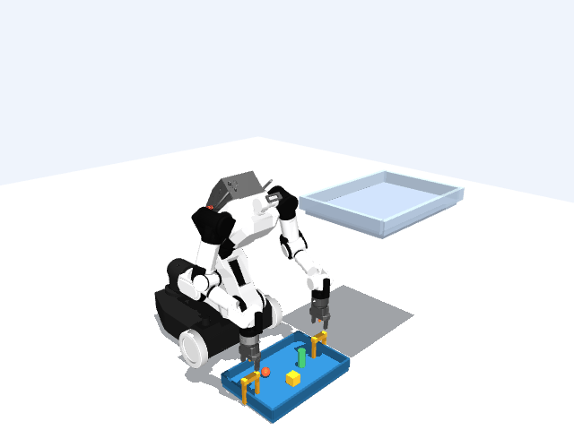
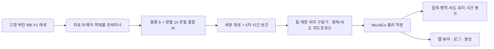

# RB-Y1 Tray Lab

**바닥 트레이를 양손으로 집어 상부 컨테이너에 놓는 MuJoCo 조작 실험.** 자유 강체 적재물 3개를 유지하고, 안착 후 양손을 분리·회수하는 과정까지 접촉과 물리 상태로 평가합니다.



## 해결하려는 문제

양손의 끝점이 목표 좌표에 도착해도 트레이가 안정적으로 운반됐다고 볼 수는 없습니다. 손가락 접촉이 끊기거나 적재물이 굴러 떨어질 수 있고, 컨테이너에 걸친 상태를 안착으로 오인할 수도 있습니다.

이 프로젝트는 **몸통·양팔을 함께 움직이는 기준 제어기와 독립 평가기**를 구성합니다. 영상의 동작 단계와 별개로 네 패드의 대향 접촉, 적재물 보존, 트레이 지지, 손 전체 분리, 회수 후 유지 시간을 검사합니다. 로봇 AI/SW 업무 중 모델·에셋 통합, 운동학·접촉 동역학, 실패 진단, 재현 가능한 실험 설계에 초점을 맞췄습니다.

## 측정 결과

기본 장면은 고정 베이스의 RBY1-A 1.2, 구·상자·원기둥 적재물, 측면 손잡이가 있는 트레이입니다. 위치 단위는 m입니다. 시드 0·1·2는 적재물 초기 XY 위치를 ±4 mm 범위에서 바꿉니다.

| 지지면 높이 | 초기 배치 | 전체 태스크 | 최대 관절 추종 오차 |
|---|---|---|---|
| 0.75 | 시드 0·1·2 | 3/3 성공 | 약 0.00285 rad |
| 0.80 | 시드 0·1·2 | 3/3 안착 전 접촉 이탈 | 약 0.00279 rad (실패 시점까지) |
| 0.85 | 시드 0·1·2 | 경로의 IK 조건 불충족 | 물리 실행 전 판정 |

시험한 조건에서 성공한 최고 지지면은 **0.75 m**입니다. 0.80 m에서는 운반 중 접촉 이탈을 검출했습니다. 관절 추종 오차가 작아도 안정적인 파지를 보장하지 않는 사례입니다. 이 표는 정해진 경로와 작은 초기 배치 변화의 반복 실행 결과이며, 로봇의 전역 최대 작업 높이를 뜻하지 않습니다.

같은 0.75 m 장면의 비교 결과는 다음과 같습니다.

| 비교 조건 | 관측 결과 |
|---|---|
| 기본 궤적: 이동 시간 배율 2 | 파지·안착·해제·회수 성공 |
| 빠른 궤적: 이동 시간 배율 1 | 30.196초에 안착 전 접촉 이탈 |
| 몸통 고정: 팔 14관절만 최적화 | 상승 경로에서 팔–컨테이너 충돌로 계획 중단 |
| 적재물 질량 2배: 합계 0.270 kg | 시드 0에서 전체 태스크 성공 |

원본 설정·접촉 기록·결과·실행 버전·해시는 [`evidence`](evidence/)에서 확인할 수 있습니다. 비교군과 질량 변화 결과는 [`evidence/experiments.json`](evidence/experiments.json)에 기록합니다.

## 구현 방법



- **역기구학(IK):** 두 손의 목표 위치·방향을 함께 풀고 관절 범위, 중력 토크 여유, 장면 충돌을 검사합니다. 이동 경로를 최대 35 mm 간격으로 나눠 해를 이어갑니다.
- **제어:** 물리·제어·성공/실패 판정 주기 2 ms, 로그 저장 주기 20 ms입니다. 구동기 게인과 힘 제한은 원본을 유지합니다. 이동 시간 배율을 바꿔 접촉 유지와 추종 오차를 비교합니다.
- **물리 파지:** 트레이와 적재물은 자유 관절을 갖습니다. 실행 중 위치·속도를 덮어쓰거나 물체를 로봇에 부착하는 제약을 사용하지 않습니다. 각 손의 두 패드 접촉과 반대 방향 법선, 패드별 최소 힘을 확인합니다.
- **안착:** 손잡이·테두리까지 포함한 트레이 경계가 컨테이너 내부에 들어가고 바닥 접촉으로 지지돼야 합니다. 적재물 3개 모두 트레이 윗면에 지지된 저속 상태를 유지하고 트레이 기울기가 0.05 rad 이하여야 합니다.
- **해제·회수:** 모든 로봇–트레이 접촉이 사라지고 양손이 손잡이에서 80 mm 이상 떨어진 뒤 0.5초 유지돼야 성공입니다. 실패는 최초 원인과 시각을 보존합니다.
- **비교군:** 몸통 관절을 같은 낮은 파지 자세에 고정한 14자유도 팔 IK도 구성했습니다. 모든 모드에서 몸통·양팔 20개 구동기를 계속 제어합니다.

## 실행

Linux의 Python 3.12, CPU/EGL 환경에서 검증했습니다. 아래 명령은 저장소 루트에서 실행합니다. `git`, Python, 시스템의 OpenGL/EGL 구현이 필요합니다.

```bash
git clone https://github.com/mmporong/rby1-tray-lab.git
cd rby1-tray-lab
python3 -m venv .venv
.venv/bin/python -m pip install -r requirements-lock.txt
.venv/bin/python -m pip install --no-deps -e .
.venv/bin/python -m rby1_tray.cli fetch-assets
.venv/bin/python -m unittest discover -s tests -v
.venv/bin/python -m rby1_tray.cli audit
.venv/bin/python -m rby1_tray.cli run --output artifacts/demo --render
.venv/bin/python -m rby1_tray.cli view --port 8786
```

뷰어 주소는 `http://127.0.0.1:8786`입니다. 재생·일시정지·50스텝·초기화·카메라 회전·상태 JSON 저장을 지원합니다. 뷰어는 녹화 영상 대신 현재 MuJoCo 세션을 적분하고 렌더링합니다. CLI GIF는 약 4배속입니다.

```bash
# 높이와 초기 배치를 바꿔 실행합니다. 실패 조건이 있으면 종료 코드는 1입니다.
.venv/bin/python -m rby1_tray.cli benchmark \
  --heights 0.75,0.8,0.85 --seeds 0,1,2 --output artifacts/heights

# 공개 증거의 해시, 소스 일치, 최종 trace와 결과 일치를 검사합니다.
.venv/bin/python tools/verify_evidence.py evidence/dataset evidence/demo \
  evidence/ablations/fast evidence/ablations/fixed evidence/ablations/heavy

# 공개 scene.xml을 열 때 고정 버전 메시의 로컬 링크를 연결합니다.
.venv/bin/python -m rby1_tray.cli fetch-assets --output evidence/demo
```

실행 폴더는 덮어쓰지 않습니다. `config.json`, `scene.xml`, `model-audit.json`, `upstream.json`, `ik.json`, `trace.jsonl`, `result.json`, `manifest.json`이 생성됩니다. 계획 단계에서 조건을 만족하지 못한 실행은 `planning_infeasible`, `physics_executed=false`로 구분합니다. 공개 trace는 gzip으로 압축했으며 검사 도구가 압축을 풀지 않고 원본 해시를 확인합니다.

## 모델링 범위

| 항목 | 이 실험의 조건 |
|---|---|
| 베이스 | 월드에 고정한 조작 지그 |
| 관측 | 시뮬레이터의 위치·속도·접촉력 |
| 제어 방법 | 수치 결합 IK와 위치 구동기 기준 제어 |
| 적재물 | 독립 자유 강체 3개, 기본 합계 0.135 kg |
| 손가락 | 원본 시각 메시 + 합성 평면 접촉 패드 |
| 실행 | CPU MuJoCo, EGL 렌더링 |
| 결과 범위 | 합성 장면의 상체 조작·접촉·안착 |

MuJoCo를 선택한 이유는 마찰 파지, 구름·미끄러짐, 물체 지지, 해제 후 거동을 같은 장면에서 계산하고 판정하기 위해서입니다. 이 구현의 벤치마크는 CPU 에피소드를 순차 실행합니다. GPU 병렬 학습이나 실물 전이 성능을 이 결과에 포함하지 않습니다.

패드 치수와 원본 메시의 수치 차이, 구조 인접 충돌 제외, 합성 파라미터와 실물 해석의 경계는 [`docs/modeling.md`](docs/modeling.md)에 기록했습니다.

## 검증

- 물체 부착, 상태 덮어쓰기, 한 물리 스텝의 금지 접촉, 한쪽 방향 파지, 떠 있는 적재물, 아래쪽 지지, 기울어진 안착, 불완전 해제 등의 반례를 포함한 **48개 테스트 통과**.
- `compileall` 통과 및 별도 code-reviewer의 핵심 구현 승인.
- 최종 실행은 고정된 코드 커밋으로 생성하고 실행 중 소스 변경을 거부합니다. 집계 검사는 사전 등록한 높이×시드 조합과 각 실행 결과의 일치까지 확인합니다.
- Python LSP 기반 정적 진단은 수행 범위에 포함하지 않았습니다.

## 출처와 라이선스

- 로봇 모델: [Google DeepMind MuJoCo Menagerie — RB-Y1](https://github.com/google-deepmind/mujoco_menagerie/tree/cda5236f98383f6fbaa4820c6b18dba892cd087f/rainbow_robotics_rby1), Apache-2.0. 원본은 별도 캐시에 받아 고정 커밋·원격·작업 트리·파일 해시를 검사합니다.
- 물리 엔진: [MuJoCo 공식 문서](https://mujoco.readthedocs.io/en/stable/overview.html).
- 문제 설정 참고: [Tommy Cohn — Inverse Function Theorem Parameterization](https://tommycohn.com/inverse-function-theorem-parameterization/). 이 저장소에서 사용하는 방법은 위에 설명한 수치 IK 기준 제어입니다.
- 이 저장소의 코드와 문서: [MIT](LICENSE). 렌더 영상에는 위 Apache-2.0 모델이 사용됐습니다.
