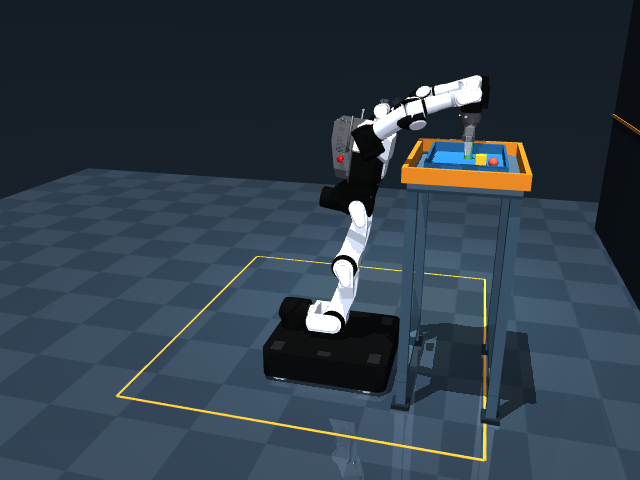
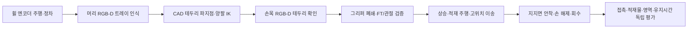

# RB-Y1 Tray Lab

**RGB-D로 바닥 트레이를 인식하고, 양팔 파지·적재 주행·높은 컨테이너 안착을 물리로 검증하는 RB-Y1 실험.**

핵심 문제는 양손이 좌표에 도달하는 것을 넘어, 주행과 몸통 상승 중에도 트레이 접촉과 세 적재물을 유지하고 실제 지지면에 내려놓는 것이다. 관측·계획·제어와 독립 평가를 연결하고, 실패 원인과 실물 전이에 필요한 데이터를 실행별로 보존한다.



[성공 영상 · 약 4배속 MP4](evidence/mobile-native/rollout.mp4) · [GIF](evidence/mobile-native/rollout.gif) · [센서 관측 미리보기](evidence/mobile-native/sensor-preview.png) · [실행 근거와 데이터](evidence/mobile-native/README.md) · [대표 실패 영상 2개](evidence/failures/README.md)

커밋 기반 전체 실행은 **102.47초에 파지·상승·안착·해제·회수 5개 조건을 통과**했다. 트레이 중심 최고 높이는 1.307 m, 목표 지지면은 1.20 m다. 세 적재물을 유지했고, 금지 충돌·물체 부착·실행 중 상태 덮어쓰기는 없었다. 이는 고정된 한 설정의 재현 결과이며 실물 전이 성능이나 성공률 통계가 아니다.

| 검증 항목 | 기록 |
|---|---|
| 최대 관절 추종 오차 | 0.004397 rad |
| 최대 관절 구동기 토크 | 239.197 Nm, 설정한 힘 제한 안 |
| 파지 후 첫 안착 전 요약 기록 | 3,417개 모두 secure, 최소 손가락 접촉력 2.692 N |
| 제어 데이터 | 500 Hz·51,235 패킷, 몸통/양팔/머리/휠/그리퍼/FT |
| RGB-D | 머리·양손목 3대, 단계 경계 5프레임 |
| 자동 검증 | 테스트 90개, 산출물/소스 해시·오프라인 인식 재실행 통과 |

## 현재 기본 구성

| 항목 | 구현 |
|---|---|
| 로봇 | 고정 버전 Menagerie RBY1-M 1.2, 자유 베이스·4휠 |
| 대상 | 손잡이가 없는 트레이의 테두리, 자유 강체 적재물 3개 |
| 그리퍼 | 원본 CAD·관절·구동기, CAD convex-mesh 접촉 교정 |
| 머리 | ZED X Mini 대응 RGB+깊이, 전체 트레이 인식 |
| 양 손목 | D405 대응 RGB+깊이, 닫기 전 테두리 확인 |
| 상태 관측 | 관절·휠 엔코더, 휠 오도메트리, 양 손목 6축 FT |
| 목표 | 바닥과 연결된 구조물 위 1.20 m 컨테이너 |
| 제어 | 몸통 6+양팔 14관절 수치 IK, 위치/속도 기준 제어·휠 속도 루프 |
| 실행 | CPU MuJoCo·EGL, 2 ms 물리/제어/평가, 20 ms trace |

원본 그리퍼의 시각 메시와 기본 접촉은 다르다. 고정 upstream의 접촉 클래스가 type을 생략해 손가락이 구형으로 자동 피팅되는 것을 확인했다. 이 실험은 **원본 CAD에 type=mesh를 명시**해 손가락·EE_BODY의 convex hull로 접촉을 계산한다. 추가 파지 패드나 트레이 손잡이는 사용하지 않는다. 원본 기본 충돌 설정을 그대로 썼다는 주장은 하지 않는다. [모델링 근거](docs/modeling.md)를 참고한다.

## 관측에서 안착까지



- **인식:** 색상 분할·깊이 역투영·강건한 바닥판 추정·CAD 직사각형 적합으로 중심과 yaw를 추정한다. 잘린 관측과 치수가 맞지 않는 방해물은 거부한다. 인식 실패를 물체 정답 좌표로 대체하지 않는다.
- **좌표계:** 제어용 카메라 외부행렬은 휠 오도메트리와 관절 엔코더 FK로 만든다. live 자유 베이스 정답 TF와 물체 pose는 제어 입력에서 분리한다.
- **물리:** 트레이와 적재물은 자유 강체다. 물체 부착·mocap·실행 중 qpos/qvel 덮어쓰기·외력 운반을 사용하지 않는다. 계획용 scratch IK 상태와 실제 물리 세션을 분리한다.
- **검증:** 네 손가락의 대향 접촉과 힘, 적재물 보존, 금지 충돌, 컨테이너 바닥 지지, 손 전체 해제·80 mm 회수·0.5초 유지로 성공을 판정한다. 단계 이름만으로 성공하지 않는다.

등록된 스테이션 좌표에서 종방향으로 이동하는 과제다. SLAM·미지 환경 탐색·개별 메카넘 롤러의 횡이동을 결과에 포함하지 않는다. 1.20 m는 과제 지지면 높이이며 전역 최대 도달 높이가 아니다.

## 실행

Linux, Python 3.12, CPU/EGL 환경에서 검증한다. 저장소 루트에서 실행한다.

```bash
git clone https://github.com/mmporong/rby1-tray-lab.git
cd rby1-tray-lab
python3 -m venv .venv
.venv/bin/python -m pip install -r requirements-lock.txt
.venv/bin/python -m pip install --no-deps -e .
.venv/bin/python -m rby1_tray.cli fetch-assets
.venv/bin/python -m unittest discover -s tests -v
.venv/bin/python -m rby1_tray.cli audit
.venv/bin/python -m rby1_tray.cli run --output artifacts/mobile-demo --render
.venv/bin/python -m rby1_tray.cli view --port 8786
```

뷰어는 `http://127.0.0.1:8786`이다. 기본은 **검증된 물리 실행의 60 FPS 영상 재생**이며, **8배속으로 시작해 12·16배속까지 재생 중에 변경**할 수 있다. 일시정지·초기화·완료 후 다시 재생, 전체/파지/안착 시점 전환을 지원한다. 영상 프레임과 같은 실행의 상태·머리/양손목 RGB-D 관측을 같은 시각으로 맞춘다. 미래 시각의 센서 관측은 표시하지 않는다. 기존 성공 GIF는 약 4배속이다.

빠른 화면 재생과 새 물리 계산은 분리한다. `evidence/playback-native`의 영상은 기존 2 ms 물리/제어를 모두 계산하면서 실제 MuJoCo 상태를 샘플링한 기록이며, 브라우저에서는 원본 8배속 영상을 1·1.5·2의 재생률로 표시한다. 물리 시간 간격을 늘리거나 누락된 움직임을 영상 보간으로 합성하지 않는다. 재생 자료가 없거나 설정·해시 검증에 실패하면 실시간 계산 모드로 표시하며, 이 모드의 실제 속도는 CPU 성능에 따른다. 새 물리 실험은 `run`으로 실행한다.

재생 기록 생성에는 기존 Python 환경과 FFmpeg/FFprobe가 필요하다. 기존 폴더를 덮어쓰지 않고 별도 경로에서 재현할 수 있다.

```bash
.venv/bin/python tools/build_playback.py --config configs/mobile-native.json --output artifacts/playback-check
```

기본 설정은 [`configs/mobile-native.json`](configs/mobile-native.json)이다. `--config`로 설정을 선택한다. 기존 실행 폴더는 덮어쓰지 않는다. `plan`은 이동형의 계획이 RGB-D 관측 이후 온라인으로 생성됨을 안내하며 실제 실행은 `run`으로 수행한다.

[대표 실패 영상 두 개](evidence/failures/README.md)도 보존한다. 실패 시점·판정·설정·버전 한계를 함께 기록한다.

## 데이터와 재현

실행 폴더에 설정·장면·모델 감사·IK·평가 trace·결과·원본 provenance·manifest와 `controller-data/`를 저장한다. RGB-D는 정차한 단계 경계에서 수집하고, 제어 패킷은 500 Hz로 저장한다. K·TF·깊이 단위·시각·센서 범위·노이즈 가정과 같은 tick의 관절·휠·FT 관측을 명시한다.

```bash
# 명령/센서 시간 정렬·범위·보정행렬을 검사하고 RGB-D 인식을 오프라인 재실행한다.
.venv/bin/python tools/verify_controller_data.py artifacts/mobile-demo

# 산출물과 실행 당시 Git 소스 해시, 최종 trace/결과 일치를 검사한다.
.venv/bin/python tools/verify_evidence.py artifacts/mobile-demo
```

센서 선택의 공식 근거, 데이터 필드·좌표계·클록, 실제 장비에서 교체할 드라이버와 실측값은 [센서·전이 계약](docs/sensors-and-transfer.md)에 정리한다. 카메라는 제조사 stereo 알고리즘을 재현한 모델이 아닌 이상적 pinhole RGB-D와 합성 노이즈다. 마운트 TF·질량·관성·마찰·servo 파라미터를 실측값으로 가장하지 않는다. 실물 실행·실물 전이 성공은 검증하지 않았다.

`evidence/demo`, `evidence/dataset`, `evidence/ablations`는 **과거 A형 고정 지그·손잡이·패드 프록시·정답 상태 실험**이다. 그 결과를 현재 RGB-D·기본 CAD 그리퍼·주행 성과로 합산하지 않는다. 과거 자료도 manifest에 기록한 소스 커밋에서 해시 검증할 수 있다.

## 이 과제에서 MuJoCo를 쓰는 이유

마찰 파지, 접촉 이탈, 적재물의 구름·미끄러짐, 지지면 안착과 해제 후 거동을 같은 장면에서 적분하고 평가하기 위해서다. RGB-D와 엔코더 관측을 재생 가능한 입력으로 기록해 인식·제어·물리 실패를 분리한다. 벤치마크는 CPU 에피소드를 순차 실행한다.

## 출처와 라이선스

- [Menagerie RB-Y1 고정 원본](https://github.com/google-deepmind/mujoco_menagerie/tree/cda5236f98383f6fbaa4820c6b18dba892cd087f/rainbow_robotics_rby1): Apache-2.0, 원본 에셋은 별도 캐시에서 무결성 검사.
- [Rainbow Robotics RB-Y1](https://www.rainbow-robotics.com/en/products/rb-y1), [공식 비전 옵션](https://www.linkedin.com/posts/rainbow-robotics_rainbowrobotics-rby1-visionsolutions-activity-7376893384017301504-JD_g): 카메라는 옵션, V1.2 FT·SDK 대응.
- [MuJoCo](https://mujoco.readthedocs.io/en/stable/overview.html), [geom/mesh 접촉 정의](https://mujoco.readthedocs.io/en/stable/XMLreference.html#body-geom).
- [Tommy Cohn — Inverse Function Theorem Parameterization](https://tommycohn.com/inverse-function-theorem-parameterization/): 문제 설정 검토 자료. 현재 구현 방법은 수치 IK 기준 제어다.
- 이 저장소 코드·문서: [MIT](LICENSE). 렌더에는 Apache-2.0 로봇 에셋을 사용한다.
