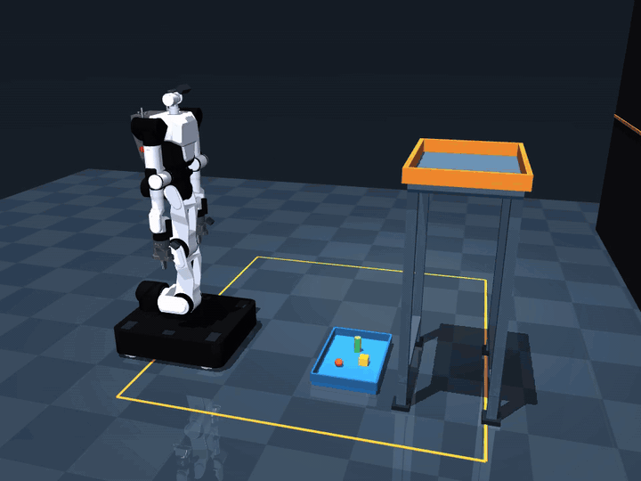
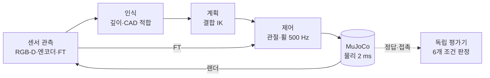
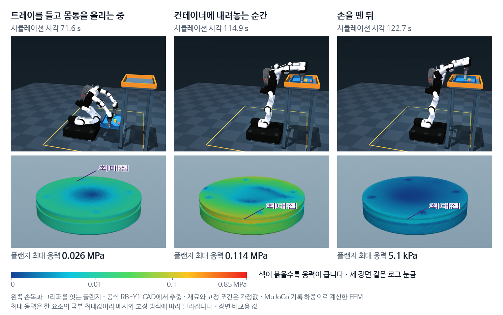
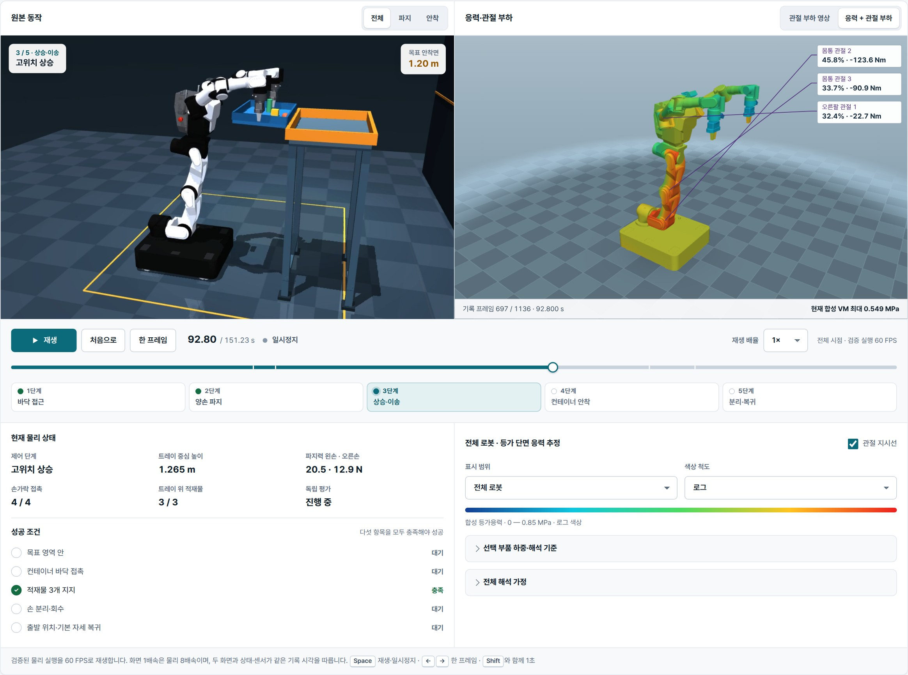

# RB-Y1 Tray Lab

RB-Y1 양팔 모바일 매니퓰레이터가 **바닥의 손잡이 없는 트레이를 RGB-D로 찾아 양손으로 잡고**, 적재물 3개를 실은 채 주행과 몸통 상승으로 **1.20 m 컨테이너에 내려놓은 뒤** 출발 위치와 기본 자세로 돌아오는 MuJoCo 물리 실험이다. 인식·계획·제어와 독립 평가를 분리하고, 실패 원인을 같은 조건의 사전 등록 비교 실험으로 검증한다. 실행 중 기록한 하중으로 각 부품이 받는 응력도 계산하고, 손목 플랜지는 공식 CAD로 FEM 해석한다.



<sub>MuJoCo 물리 실행 기록 · 화면 1초 = 물리 8초 · [MP4](evidence/playback-native/overview.mp4) · [파지 근접](evidence/playback-native/pickup.mp4) · [안착 근접](evidence/playback-native/placement.mp4) · [센서 관측](evidence/mobile-native/sensor-preview.png)</sub>

## 핵심 결과

| 항목 | 결과 | 근거 |
|---|---|---|
| 전체 과제 | 151.2초에 파지·상승·안착·해제·회수·기본 자세 복귀 6개 조건 통과, 트레이 중심 최고 1.306 m | [실행 근거](evidence/mobile-native/README.md) |
| 실패 원인 분석 | 상승 중 벽 접촉을 기록 재구성으로 확인하고, 회전한 트레이 림이 컨테이너 벽과 계산상 최대 약 9.3 mm 겹칠 수 있는 경로 결함을 특정 | [개선 연구](docs/improvement-study.md) |
| 경로 개선 검증 | 같은 조건·seed의 사전 등록 비교에서 작업 완료 6/12 → 11/12, 개선 경로의 상승 구간 벽 접촉 표본 0 | [44회 실행 근거](evidence/improvement/README.md) |
| 센서 이상 대응 | 카메라 보정 편향 +5 mm, RGB-D 150 ms 지연 4회 모두 설계한 검사 단계에서 작업 거부 | [44회 실행 근거](evidence/improvement/README.md) |
| 구조 해석 (CAE) | 로봇이 받은 힘을 1,136개 기록 프레임마다 응력으로 바꿔 영상과 함께 표시, 손목 플랜지는 공식 CAD로 FEM 해석. 메시 3단계 중 가장 촘촘한 두 단계 사이 최대 변위·대표 응력·변형 에너지 차이 1.7% 이내 | [구조 해석](#구조-해석-cae) |
| 재현 가능한 기록 | 500 Hz 제어 패킷 75,616개, RGB-D 3대, 양 손목 6축 FT, 실행별 소스·산출물 SHA-256, 단위 테스트 256개 | [센서·전이 계약](docs/sensors-and-transfer.md) |

## 구현 내용

- **물리 장면:** 고정 버전 Menagerie RBY1-M 1.2(자유 베이스·4휠), 360×540 mm 트레이, 자유 강체 적재물 3개, 바닥과 연결된 1.20 m 컨테이너. 트레이는 손가락 마찰 접촉만으로 들고 옮긴다.
- **인식:** 머리 RGB-D(ZED X Mini 대응)의 깊이 연결 성분·수평면·CAD 직사각형 적합으로 트레이 중심과 yaw를 추정한다. 이동 후·자세 하강 후·파지 접근 후 다시 관측해 추정 변화량을 검사하고, 양 손목 RGB-D(D405 대응)로 닫기 전 테두리 형상을 확인한다.
- **계획:** 몸통 6관절과 양팔 14관절을 함께 푸는 수치 IK가 양손 TCP 자세, 관절 한계, 중력 토크 여유, 금지 충돌을 검사한다. 실제로 실행할 C1 Hermite 경로는 구간마다 51개 자세로 충돌을 검사한다.
- **제어:** 팔은 힘 제한 위치 루프와 중력·속도 피드포워드, 베이스는 휠 오도메트리 피드백 속도 제어로 움직인다. 운반 중에는 50 Hz로 양손 상대 자세 오차와 좌우 FT 지지력 비율을 감시해 궤적 진행과 휠 속도를 조절한다.
- **독립 평가:** 제어기의 단계 이름과 별도로 2 ms마다 네 손가락의 대향 접촉·힘, 적재물 보존, 금지 충돌, 컨테이너 지지, 손 해제·80 mm 회수, 복귀 자세를 판정한다.
- **모델 교정:** 고정한 upstream 그리퍼 충돌 클래스가 geom type을 생략해 손가락 접촉이 반경 약 15 mm 구로 자동 피팅되는 것을 확인했다. EE_BODY와 손가락에 `type=mesh`를 명시해 원본 CAD의 convex hull로 접촉을 계산한다. [모델링 근거](docs/modeling.md)

## 시스템 구성

제어기는 센서 관측만 받는다. 시뮬레이터의 정답 pose와 접촉 정보는 독립 평가기만 사용한다.



## 과제 흐름과 대표 실행 지표

| 단계 | 내용 | 대표 실행 시각 |
|---|---|---:|
| 접근·인식 | 모델 기본 자세에서 이동 자세로 전환하고, 주행·정차 후 머리 RGB-D로 트레이를 찾는다 | 0 s부터 |
| 양손 파지 | 파지 자세로 낮춰 다시 관측하고, 손목 RGB-D로 테두리를 확인한 뒤 양손으로 잡는다 | 42.9 s |
| 상승 | 트레이 바닥이 처음보다 30 mm 이상 올라간다 | 47.2 s |
| 적재 주행·고위치 이송 | 몸통을 올리고 주행해 컨테이너 위로 옮긴다 | |
| 안착 | 1.20 m 컨테이너 지지면에 트레이 전체를 내려놓는다 | 114.1 s |
| 해제·회수 | 손을 열고 두 TCP를 파지점에서 80 mm 이상 떨어뜨린다 | 118.1 s · 122.6 s |
| 복귀 | 상체를 유지한 채 0.93 m 후진하고, 모델 기본 자세로 돌아와 0.5초 정지한다 | 151.2 s |

| 지표 | 기록 |
|---|---|
| 최대 관절 추종 오차 | 0.004848 rad |
| 최대 관절 구동기 토크 | 239.207 Nm, MuJoCo 모델 구동기 값, 모델 힘 제한 안 |
| 파지 후 첫 안착 전 기록 | 3,559개 표본 모두 secure, 최소 손가락 접촉력 2.534 N |
| 복귀 후 관절 자세 오차 | 최대 0.000651 rad, 기준 0.01 rad |
| 복귀 후 베이스 위치 오차 | 10.859 mm, 기준 20 mm |
| 제어 데이터 | 500 Hz 75,616 패킷, 몸통·양팔·머리·휠·그리퍼·FT |
| RGB-D | 머리·양 손목 3대, 제어 7프레임과 1 Hz 모니터 456프레임 |

## 실패 분석과 경로 개선

**관찰.** 트레이 yaw +0.035 rad(약 2°) 조건의 seed 0에서 상승하던 트레이 림이 컨테이너 근측 벽에 걸렸다. 원본 trace를 장면의 충돌 형상으로 재구성하니 첫 접촉은 87.16 s(최저 접촉 거리 −0.687 mm)였고, 트레이 pitch가 커진 뒤 104.034 s에 적재물이 빠졌다. 베이스 기울기와 양손 상대 자세 오차가 커지기 전에 벽 접촉이 먼저 나타났다.

**원인.** 기존 상승 경로는 컨테이너 내부 경계에서 트레이 바닥 반폭 0.18 m와 여유 0.03 m만 빼 트레이 중심을 x=0.740 m에 두었다. 실제 벽 외부 면은 x=0.926 m이고, 림을 포함해 0.035 rad 회전한 트레이의 +X 외곽은 0.1953 m다. 회전한 외곽이 벽 안으로 약 9.3 mm 들어갈 수 있었다.

**수정.** [`transport_clearance.py`](src/rby1_tray/transport_clearance.py)가 컴파일된 모델에서 트레이 바닥·림 box 5개와 컨테이너 벽 box 4개를 읽고, RGB-D로 추정한 yaw만큼 회전한 외곽으로 후퇴 위치를 계산한다.

```text
safe_x = min(start_x, near_wall_outer_x − rotated_tray_positive_x_support − 0.03 m)
```

**검증.** 소스 커밋 `7c2ba29`를 고정하고 44회 실행 행렬을 실행 전에 등록했다. 검증용 yaw +0.025 rad는 구현 전에 정해 경로 조정에 쓰지 않았다. 인식·파지·협조 감시·성공 판정의 임계값은 그대로 유지했다.

| 조건 | 기존 경로 완료 | 개선 경로 완료 | 상승 중 벽 접촉 표본 (seed 0 / 1): 기존 | 개선 |
|---|---:|---:|---:|---:|
| 기본 조건 | 2/2 | 2/2 | 0 / 0 | 0 / 0 |
| 깊이 잡음 3 mm·누락 3% | 2/2 | 2/2 | 0 / 0 | 0 / 0 |
| 적재물 질량 1.2배 | 2/2 | 2/2 | 0 / 0 | 0 / 0 |
| 트레이 yaw +0.035 rad | 0/2 | 1/2 | 198 / 19 | 0 / 0 |
| 트레이 yaw −0.035 rad | 0/2 | 2/2 | 172 / 251 | 0 / 0 |
| 검증용 yaw +0.025 rad | 0/2 | 2/2 | 278 / 300 | 0 / 0 |
| **합계** | **6/12** | **11/12** | | |

- 기존 경로가 완료한 6쌍은 개선 경로도 모두 완료했고, 이 6쌍에서 개선 경로의 완료 시간은 평균 0.10 s 길었다.
- 센서 이상 4회는 모두 의도한 단계에서 작업을 멈췄다. 보정 편향 +5 mm는 손목 검증에서 2/2회, RGB-D 150 ms 지연은 인식 단계에서 2/2회 거부됐다.
- 벽 접촉은 20 ms 기록 표본을 충돌 형상으로 재구성해 센다. [기존 경로 벽 간섭 영상](evidence/improvement/videos/0.mp4)을 함께 보존했다.

**남은 1건의 원인 추적.** yaw +0.035 rad·seed 1의 개선 경로는 상승 구간 기록 표본 3,243개에서 벽 접촉이 0이었고, 높은 위치 주행 단계에서 도착 기준을 2.3 mm 남긴 채 단계 시간 예산 20 s를 넘겼다. 협조 감시는 첫 운반 표본의 좌우 하중 불균형 +0.658을 기준으로 고정한다. 이후 하중이 −0.012로 균형에 가까워져도 기준과의 차이 때문에 감속(평균 속도 배율 0.45)이 이어졌고, 단계 시간 예산은 감속과 무관한 물리 시각으로 계산된다. 같은 조건에서 협조 감속을 끈 실행은 148.4 s에 전체 과제를 완료했다. 시간 초과로 끝난 이 실행도 판정 기준을 그대로 둔 채 결과에 포함했다. [실행 영상](evidence/improvement/videos/1.mp4)

**협조 감속 비용.** 16회 비교에서 감속 사용 7/8회, 해제 8/8회가 완료됐다. 양쪽 모두 완료한 7쌍의 평균으로 보면, 감속을 쓸 때 완료 시간은 1.18 s 길고 최대 트레이 기울기는 0.14 mrad 작았으며 최대 적재물 변위는 0.64 mm 컸다.

방법·측정 규약·재현 명령은 [개선 연구 문서](docs/improvement-study.md), 실행별 결과 44행은 [실행 근거](evidence/improvement/README.md)에 있다. 초기 조건 비교 18회는 [조건별 비교 근거](evidence/robustness/README.md)에 보존했다.

## 구조 해석 (CAE)

로봇이 움직이는 동안 각 부품이 힘을 얼마나 받는지도 계산했다. MuJoCo 실행 기록에서 부품마다 걸린 힘과 모멘트를 꺼내, 그 힘이 부품 안에 만드는 응력을 프레임마다 구한다. 물리 실행이 끝난 뒤 기록만 읽는 후처리라 로봇 동작에는 영향을 주지 않는다.



위 그림은 왼쪽 손목과 그리퍼를 잇는 플랜지(지름 63 mm, 두께 11 mm인 원판 부품)의 응력이다. 위는 같은 순간의 로봇 동작이고, 색이 붉을수록 응력이 크다. 전체 기록 중 이 플랜지의 응력이 가장 큰 순간은 트레이를 컨테이너에 내려놓는 114.9초이고(0.114 MPa), 손을 뗀 뒤에는 5.1 kPa로 내려간다. 그림의 최대 응력은 한 요소의 국부 최대값이라 메시 크기와 고정 방식에 따라 달라진다. 장면끼리 크기를 비교하고 시간에 따른 변화를 보는 값으로 읽는다.

### 계산 방법

| 대상 | 방법 | 하는 일 |
|---|---|---|
| 전신 36개 부품 | 단순화한 단면으로 추정 | 차체·바퀴·몸통·팔의 각 링크를 겉모양 크기에 맞춘 속이 빈 원통 단면으로 보고, 당기거나 누르는 힘·휘게 하는 힘·비트는 힘·옆으로 미는 힘이 만드는 응력을 합친다. 1,136개 기록 프레임 전부에 적용해 영상과 함께 보여 준다 |
| 하중의 출처 | 세 갈래로 나누기 | 부품에 걸린 힘을 그 부품과 끝쪽에 달린 로봇 부분의 무게를 받치는 몫, 트레이처럼 바깥 물체와 닿아서 들어온 몫, 둘을 빼고 남은 나머지(가속 등 움직임에서 생기는 몫)로 나눠 보여 준다. 힘을 나눈 것이고 응력을 원인별로 나눈 것은 아니다 |
| 왼쪽 손목 플랜지 | 공식 CAD로 FEM | Rainbow Robotics가 배포하는 RB-Y1 V1.2 CAD에서 플랜지 형상을 꺼내고, 작은 사면체 조각(메시)으로 나눠 조각마다 응력을 계산한다 |

FEM은 프레임마다 새로 풀지 않는다. 세 방향으로 미는 힘과 세 축으로 비트는 모멘트, 모두 6가지 기본 하중에 대한 결과를 미리 한 번씩 계산해 둔다. 실제 손목 하중은 이 6가지의 조합이므로, 프레임마다 기록된 하중 비율대로 6개 결과를 더하면 그 순간의 응력이 나온다. 재료가 힘에 비례해 변형하고(선형 탄성) 고정 조건이 그대로인 범위에서 성립하는 방법이고, 덕분에 뷰어에서 영상을 재생하면 플랜지 응력도 함께 바뀐다.

### 계산 점검

아래 항목은 계산 자체가 일관적인지 점검한 것이다.

| 확인 | 결과 | 뜻 |
|---|---|---|
| 메시를 더 잘게 나누기 | 조각 크기를 2.8, 2.0, 1.4 mm로 줄이는 세 단계 중 마지막 두 단계(2.0 mm와 1.4 mm) 사이 최대 변위·대표 응력·변형 에너지 차이가 1.7% 이내 (기준 5%) | 가장 촘촘한 두 메시의 답이 거의 같다 |
| 힘의 균형 | 가한 힘과 고정면이 받치는 힘의 상대 차이 6.5×10⁻¹⁵ 이하 | 계산이 힘과 모멘트의 평형을 지킨다 |
| 에너지 | 부품에 쌓인 변형 에너지와 하중이 한 일의 관계식(2U = Fᵀu) 상대 오차 7.5×10⁻¹⁶ | 계산이 에너지 관계를 지킨다 |
| 고정 방식 바꾸기 | 윗면 전체 대신 바깥 테두리만 고정하면 한 점의 최대 응력은 2.78배, 대표 응력은 1.23배 | 볼트 체결 방식에 따라 결과가 달라지는 정도를 함께 기록 |
| 단위 테스트 | 식으로 정답을 구할 수 있는 축방향 하중 문제와 대조, 하중을 두 배로 하면 응력도 두 배인지, 좌표를 옮겨도 결과가 같은지 검사 | 계산 코드 자체를 검사 |

대표 응력은 부피 기준으로 응력이 큰 쪽 5% 경계값(P95)이다. 한 점의 최대값은 메시 크기에 민감한 지표라, 메시 비교에는 이 값을 쓴다. 기준 하중은 몸통을 높이 올리는 71.704초의 손목 하중이고, 그림 첫 장면(영상 프레임 기준 71.6초)과는 시각이 달라 값도 다르다.

| 조각 크기 | 노드 수 | 사면체 수 | 최대 변위 | 대표 응력 (P95) |
|---|---:|---:|---:|---:|
| 2.8 mm | 2,577 | 9,736 | 4.794 nm | 0.0201 MPa |
| 2.0 mm | 5,116 | 21,048 | 4.761 nm | 0.0206 MPa |
| 1.4 mm | 12,165 | 55,946 | 4.844 nm | 0.0209 MPa |

### 가정

- 전신 단면의 두께는 반지름의 10%(1~6 mm)로 정한 값이고, 부품 내부 구조는 반영하지 않는다. 차체는 네 바퀴와 몸통 부착부의 반력을 각각 계산해 지표가 가장 큰 부착부 하나를 표시한다.
- CAD에 재료 정보가 없어 알루미늄 수준의 값(탄성계수 69 GPa, 푸아송비 0.33)을 넣었다.
- 플랜지 윗면을 고정하고, 손목 힘 센서의 하중이 플랜지 아랫면 중심에 같은 축으로 걸린다고 본다.
- 공식 CAD는 Fast Grip 그리퍼 구성이라 시뮬레이션 손가락과 치수가 다르다. 이 FEM은 시뮬레이션에서 기록한 하중을 실제 제품 부품 형상에 옮겨 계산한 해석으로 읽는다.

저장소에는 뷰어 화면을 캡처한 결과 그림과 수치 요약을 담았고, STEP·BREP·메시와 구조 번들은 로컬에 둔다. STEP 원본은 Rainbow Robotics 제품 페이지에서 동의 양식을 작성한 뒤 받을 수 있다. [계산 가정·검증·재현 절차](docs/structural-analysis.md) · [CAD 확보 경위](docs/structural-cad.md) · [플랜지 수치 요약](evidence/structural-flange/summary.json) · [전신 요약](evidence/structural-whole/summary.json)

## 디지털 트윈 뷰어



- 검증된 물리 기록을 60 FPS로 재생한다. 화면 1배속은 물리 8배속이며 1·1.5·2배속을 고를 수 있다.
- 두 화면이 하나의 재생 바를 공유한다. 재생 바로 원하는 프레임으로 이동하고, 단계 버튼으로 바닥 접근부터 분리·복귀까지 다섯 작업 단계의 시작점에 바로 갈 수 있다. 키보드는 Space로 재생하고 ←/→로 한 프레임, Shift와 함께 1초씩 움직인다.
- 재생 바 아래의 제어 단계·트레이 높이·손가락 접촉·적재물 수와 성공 조건 다섯 항목이 같은 기록 시각으로 갱신된다.
- 오른쪽 화면은 같은 기록 프레임의 전신 구조 응력과 몸통·양팔 20관절 부하를 겹쳐 그리고, 부하가 큰 관절을 지시선과 사용률·토크로 가리킨다.
- 머리·양 손목의 RGB와 깊이 6패널, 부품별 6축 하중 진단, 개선 전후 비교 화면을 함께 제공한다.
- 관절 부하는 MuJoCo 구동기 토크를 모델 토크 제한으로 나눈 값이다. 응력 계산 방법은 [구조 해석](#구조-해석-cae) 절에 정리했다.
- 전신 응력 화면은 CAD 파생 구조 번들을 준비한 환경에서 열린다. 새 clone에서는 원본 동작·관절 부하 영상·RGB-D·개선 비교 화면을 볼 수 있다. 화면 구성과 해석 규약은 [기술 상세](docs/technical-details.md#관절-부하와-접촉력-시각화)에 정리했다.

## 실행

Linux, Python 3.12, CPU/EGL 환경에서 검증했다. Ubuntu·Windows WSL2 설치, 구조 번들 준비, SSH 접속은 [다른 PC 실행 가이드](docs/run-on-another-pc.md)에 정리했다. 명령은 저장소 루트에서 실행한다.

```bash
cd "$HOME"
git clone https://github.com/mmporong/rby1-tray-lab.git
cd "$HOME/rby1-tray-lab"
python3.12 -m venv .venv
.venv/bin/python -m pip install -r requirements-lock.txt
.venv/bin/python -m pip install --no-deps -e .
.venv/bin/python -m rby1_tray.cli fetch-assets
.venv/bin/python -m rby1_tray.cli audit
MUJOCO_GL=egl PYOPENGL_PLATFORM=egl EGL_PLATFORM=surfaceless \
  .venv/bin/python -m rby1_tray.cli view --port 8786
```

뷰어는 `http://127.0.0.1:8786`에서 열린다. 저장된 물리 기록을 재생하므로 새 물리 계산 없이 볼 수 있다. 새 물리 실험은 별도 출력 폴더로 실행한다.

```bash
.venv/bin/python -m rby1_tray.cli run --output artifacts/mobile-demo --render
```

재생 기록은 기존 Python 환경과 FFmpeg/FFprobe로 별도 경로에 다시 만들 수 있다. 기본 설정은 [`configs/mobile-native.json`](configs/mobile-native.json), 경로 개선 프리셋은 [`configs/mobile-native-improved.json`](configs/mobile-native-improved.json)이다.

```bash
.venv/bin/python tools/build_playback.py --config configs/mobile-native.json --output artifacts/playback-check
```

## 재현과 검증

실행 폴더마다 설정·장면·모델 감사·IK·평가 trace·결과·provenance·manifest와 `controller-data/`(RGB-D, K·TF, 엔코더, FT, 명령)를 저장한다.

```bash
# 단위 테스트 256개
.venv/bin/python -m unittest discover -s tests

# 개선 연구 44회의 행렬·설정·결과·접촉 감사·영상 바인딩 검증
.venv/bin/python tools/verify_improvement_evidence.py evidence/improvement

# 새 실행의 명령·센서 시간 정렬, 보정행렬, RGB-D 인식 오프라인 재실행
.venv/bin/python tools/verify_controller_data.py artifacts/mobile-demo

# 새 실행의 산출물과 실행 당시 소스 해시, 최종 trace·결과 일치
.venv/bin/python tools/verify_evidence.py artifacts/mobile-demo

# 조건별 비교 실험
.venv/bin/python tools/benchmark_mobile.py --output artifacts/mobile-comparison --cases nominal,gray-tray --seeds 0,1 --variants coop-depth-cad,coop-blue-rgbd
```

## 범위

- 결과는 모두 MuJoCo 시뮬레이션 실행 기록이다. MuJoCo로 마찰 파지, 적재물의 구름·미끄러짐, 안착 지지, 관절 토크를 같은 물리 실행에서 계산하고, 비교 실험은 CPU에서 에피소드를 순차 실행한다.
- 151.2초 대표 실행은 고정된 한 설정의 재현 기록이다. 비교 실험의 완료 수는 해당 조건·seed 행렬 안의 결과로 읽는다. [대표 실행 기록](docs/technical-details.md#대표-실행-기록)
- 카메라는 RB-Y1 공식 비전 옵션(ZED X Mini·D405)에 대응하는 pinhole RGB-D 렌더와 합성 노이즈다. 실물 장비에서 교체할 드라이버와 보정 항목은 [센서·전이 계약](docs/sensors-and-transfer.md)에 정리했다.
- 베이스는 등록된 스테이션 좌표에서 종방향으로 이동한다. 1.20 m는 이 과제의 컨테이너 지지면 높이다.
- 비교 실험은 조건당 seed 2개의 고정 행렬이며, 변경 효과는 같은 case·seed 쌍으로 비교한다.
- `evidence/demo`, `evidence/dataset`, `evidence/ablations`는 초기 A형 고정 지그 실험 기록이다.

## 문서

| 문서 | 내용 |
|---|---|
| [기술 상세](docs/technical-details.md) | 출발·복귀 자세, 인식·좌표계·운반 감시, 뷰어, 관절 부하·응력 해석 규약 |
| [개선 연구](docs/improvement-study.md) | 문제·가설·변경·사전 등록 행렬·측정·재현 명령 |
| [모델링](docs/modeling.md) | 장면, 그리퍼 접촉 교정, 운동 계획과 제어, 독립 판정 |
| [센서·전이 계약](docs/sensors-and-transfer.md) | 센서 선택 근거, 좌표계와 보정, 데이터 형식과 주기 |
| [구조 해석](docs/structural-analysis.md) · [CAD 확보](docs/structural-cad.md) | 응력 계산 가정, 검증, 재현 절차 |
| [다른 PC 실행](docs/run-on-another-pc.md) | 설치, 구조 번들 이전, 문제 해결 |
| [근거 목록](evidence/README.md) | 실행별 근거 폴더 안내 |

## 출처와 라이선스

- [Menagerie RB-Y1 고정 원본](https://github.com/google-deepmind/mujoco_menagerie/tree/cda5236f98383f6fbaa4820c6b18dba892cd087f/rainbow_robotics_rby1): Apache-2.0, 원본 에셋은 별도 캐시에서 무결성 검사.
- [Rainbow Robotics RB-Y1](https://www.rainbow-robotics.com/en/products/rb-y1), [공식 비전 옵션](https://www.linkedin.com/posts/rainbow-robotics_rainbowrobotics-rby1-visionsolutions-activity-7376893384017301504-JD_g): 카메라는 옵션, V1.2 FT·SDK 대응.
- [MuJoCo](https://mujoco.readthedocs.io/en/stable/overview.html), [geom/mesh 접촉 정의](https://mujoco.readthedocs.io/en/stable/XMLreference.html#body-geom).
- [Tommy Cohn — Inverse Function Theorem Parameterization](https://tommycohn.com/inverse-function-theorem-parameterization/): 문제 설정 검토 자료. 현재 구현 방법은 수치 IK 기준 제어다.
- [RB-Y1 공식 3D CAD](https://www.rainbow-robotics.com/en/products/rb-y1): V1.2 Mecanum STEP. 플랜지 FEM 그림의 형상을 이 CAD에서 추출했다. [확보 경위](docs/structural-cad.md)
- 이 저장소 코드·문서: [MIT](LICENSE). 렌더에는 Apache-2.0 로봇 에셋을 사용한다.
