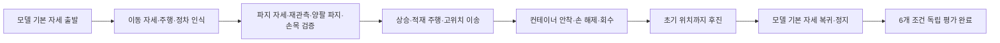
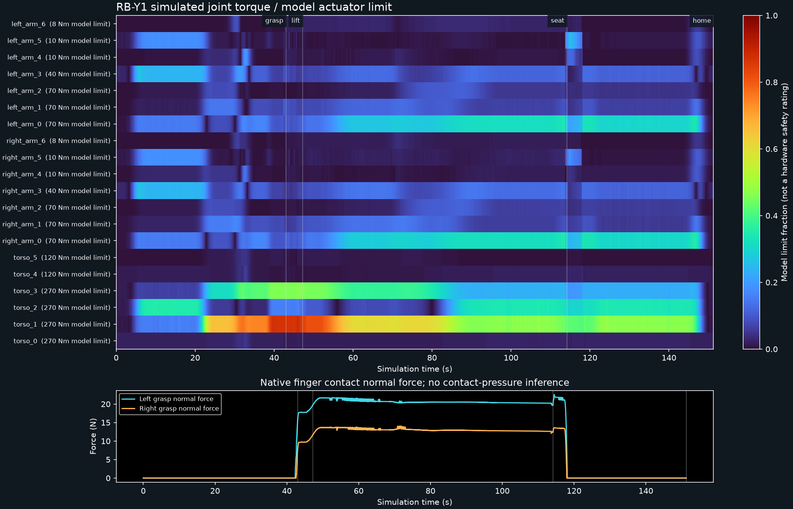

# 기술 상세: 과제 흐름·뷰어·부하 해석

[README](../README.md)의 요약 뒤에 있는 구현·실행·해석 규약을 모았다. 수치와 판정 기준은 각 절이 연결하는 evidence 파일이 원본이다.

## 대표 실행 기록

주행과 몸통 상승 중 트레이 접촉과 세 적재물을 유지하고, 컨테이너 지지면에 내려놓는 과제를 다룬다. 관측·계획·제어와 독립 평가를 연결하고, 실패 원인과 실물 전이에 필요한 데이터를 실행별로 보존한다.

MuJoCo는 손가락 접촉, 적재물의 자유 운동, 관절 토크와 안착 지지를 같은 물리 실행에서 계산하고 조건별 실패를 재현하는 데 사용한다. 현재 비교실험은 CPU 프로세스로 실행하며, MJX의 GPU 배치 학습이나 강화학습 정책은 사용하지 않는다.


[성공 영상 · 약 4배속 MP4](../evidence/mobile-native/rollout.mp4) · [GIF](../evidence/mobile-native/rollout.gif) · [센서 관측 미리보기](../evidence/mobile-native/sensor-preview.png) · [실행 근거와 데이터](../evidence/mobile-native/README.md) · [대표 실패 영상 2개](../evidence/failures/README.md)

커밋 기반 전체 실행은 **151.232초에 파지·상승·안착·해제·회수·기본 자세 복귀 6개 조건을 통과**했다. 트레이 중심 최고 높이는 1.306 m, 목표 지지면은 1.20 m다. 세 적재물을 유지했고, 금지 충돌·물체 부착·실행 중 상태 덮어쓰기는 없었다. 이는 고정된 한 설정의 재현 결과이며 실물 전이 성능이나 성공률 통계가 아니다.

## 출발·복귀 자세

출발·종료 자세는 원본 모델의 `qpos0`다. 몸통·양팔 20관절과 헤드는 0 rad, 그리퍼는 0 m이고 베이스는 설정된 초기 위치로 돌아온다. 이동 준비 자세로 접근·정차한 뒤 머리 RGB-D로 트레이를 찾고, 파지 자세로 낮춘 후와 파지 접근 후에 다시 관측한다. 관측 변화량이 허용 범위를 벗어나면 작업을 거부하며, 픽업 위치에서 다시 기립하는 경유는 없다. 안착·손 회수 뒤에는 상체를 유지하고 후진한 다음 기본 자세로 복귀한다. [왕복 검증 근거](../evidence/mobile-native/home-cycle-validation.json)에 시작·종료 실제 상태와 후진 거리를 기록했다.

## 현재 기본 구성

| 항목 | 구현 |
|---|---|
| 로봇 | 고정 버전 Menagerie RBY1-M 1.2, 자유 베이스·4휠 |
| 대상 | 손잡이가 없는 트레이의 테두리, 자유 강체 적재물 3개 |
| 그리퍼 | 원본 CAD·관절·구동기, CAD convex-mesh 접촉 교정 |
| 머리 | ZED X Mini 대응 RGB+깊이, 전체 트레이 인식 |
| 양 손목 | D405 대응 RGB+깊이, 닫기 전 테두리 확인 |
| 상태 관측 | 관절·휠 엔코더, 휠 오도메트리, 양 손목 6축 FT |
| 목표 | 바닥과 연결된 구조물 위 1.20 m 컨테이너 |
| 제어 | 몸통 6+양팔 14관절 수치 IK, 위치/속도 기준 제어·휠 속도 루프, 상대 자세·FT 기반 운반 감속 |
| 실행 | CPU MuJoCo·EGL, 2 ms 물리/제어/평가, 20 ms trace |

원본 그리퍼의 시각 메시와 기본 접촉은 다르다. 고정 upstream의 접촉 클래스가 type을 생략해 손가락이 구형으로 자동 피팅되는 것을 확인했다. 이 실험은 **원본 CAD에 type=mesh를 명시**해 손가락·EE_BODY의 convex hull로 접촉을 계산한다. 추가 파지 패드나 트레이 손잡이는 사용하지 않는다. 원본 기본 충돌 설정을 그대로 썼다는 주장은 하지 않는다. [모델링 근거](modeling.md)를 참고한다.

## 관측에서 안착까지



- **인식:** 기본은 색상을 사용하지 않는 깊이 연결 성분·수평면·CAD 직사각형 적합이다. 잘린 관측, 치수가 맞지 않는 방해물, 위치가 다른 복수의 동일 형상 후보를 거부한다. 이동 후·자세 하강 후·파지 접근 후 추정 변화량을 검사하며, 손목은 국소 테두리 깊이 형상을 확인한다. 기존 파란색 RGB-D 방식은 비교군으로 유지한다. 이는 알려진 수평 트레이의 형상 인식이며 임의 물체의 의미 분류는 아니다.
- **좌표계:** 제어용 카메라 외부행렬은 휠 오도메트리와 관절 엔코더 FK로 만든다. live 자유 베이스 정답 TF와 물체 pose는 제어 입력에서 분리한다.
- **운반 감시:** 50 Hz로 엔코더 FK의 양손 상대 자세 오차와 도구 중력을 보상한 좌우 FT 지지력 비율의 변화를 검사한다. 기준 궤적 시간과 휠 속도를 낮추며, 지속되는 임계 초과는 실패로 종료한다. 힘 목표를 추종하는 임피던스 제어는 아니다.
- **물리:** 트레이와 적재물은 자유 강체다. 물체 부착·mocap·실행 중 qpos/qvel 덮어쓰기·외력 운반을 사용하지 않는다. 계획용 scratch IK 상태와 실제 물리 세션을 분리한다.
- **검증:** 네 손가락의 대향 접촉과 힘, 적재물 보존, 금지 충돌, 컨테이너 바닥 지지, 손 전체 해제·80 mm 회수와 초기 위치·기본 자세 복귀 후 0.5초 정지로 성공을 판정한다. 복귀 중에도 안착과 적재물 상태를 계속 검사한다. 단계 이름만으로 성공하지 않는다.

등록된 스테이션 좌표에서 종방향으로 이동하는 과제다. SLAM·미지 환경 탐색·개별 메카넘 롤러의 횡이동을 결과에 포함하지 않는다. 1.20 m는 과제 지지면 높이이며 전역 최대 도달 높이가 아니다.

## 실행

Linux, Python 3.12, CPU/EGL 환경에서 검증한다. [다른 PC 실행 가이드](run-on-another-pc.md)에 Ubuntu·Windows WSL2 설치, 구조 번들 준비, SSH 접속과 문제 해결을 정리했다. 저장소 루트에서 실행한다. 기존 재생 자료를 보는 데 새 물리 실험은 필요하지 않다.

```bash
cd "$HOME"
git clone https://github.com/mmporong/rby1-tray-lab.git
cd "$HOME/rby1-tray-lab"
python3.12 -m venv .venv
.venv/bin/python -m pip install -r requirements-lock.txt
.venv/bin/python -m pip install --no-deps -e .
.venv/bin/python -m rby1_tray.cli fetch-assets
.venv/bin/python -m rby1_tray.cli audit
MUJOCO_GL=egl PYOPENGL_PLATFORM=egl EGL_PLATFORM=surfaceless \
  .venv/bin/python -m rby1_tray.cli view --port 8786
```

뷰어는 `http://127.0.0.1:8786`이다. 인터페이스는 OS 테마와 관계없이 화이트 톤을 기본으로 사용하며 패널·표·조작부를 밝게 표시한다. 기본은 **검증된 물리 실행의 60 FPS 영상 재생**이며, **기존 8배속을 화면의 1배속으로 삼아 1·1.5·2배속으로 재생 중에 변경**할 수 있다. 구조 번들을 준비한 첫 화면은 원본 동작과 **전신 구조 응력 + 몸통·양팔 20관절 부하**를 16:10 같은 크기로 나란히 놓고, 두 화면 아래에 공통 재생 바를 둔다. 원본 동작 화면은 960×720 기록 영상을 16:10 틀에 맞춰 위아래 가장자리를 약 8%씩 잘라 보여 준다. 화면 왼쪽 위에는 현재 작업 단계, 오른쪽 위에는 목표 안착면 높이를 표시한다. 재생 바는 프레임 단위 이동, 다섯 작업 단계 경계 눈금과 단계 시작점 이동 버튼을 제공하고, 키보드는 Space로 재생, ←/→로 한 프레임, Shift와 함께 1초씩 이동한다. 그 아래 제어 단계·시뮬레이션 시간·트레이 높이·손가락 접촉·적재물·독립 평가와 성공 조건 다섯 항목이 같은 기록 시각으로 갱신된다. 오른쪽 화면은 0.25 m 간격의 회청색 디지털 트윈 바닥에서 응력 색상과 관절 부하 지시선을 같은 기록 프레임에 겹친다. 이 격자는 시각 배경이며 물리 충돌체를 추가하지 않는다. 다음 구역에서 머리·왼손목·오른손목의 RGB와 깊이 6패널을 보고, 응력 해석 구역에서 표시 범위·색상 척도, 관절 부하 요약, 선택 부품의 6축 합력·하중 경로·응력 성분을 확인한다. `관절 부하 영상`으로 바꾸면 기존 비교 영상을 같은 시각에 재생한다. 재생·일시정지·한 프레임·초기화·배율·완료 후 다시 재생과 시점 변경은 원본 영상 시각을 기준으로 적용한다. 좁은 화면에서는 두 주 화면과 RGB-D 패널을 세로로 배치한다. 카메라 행은 확대할 수 있다. 같은 실행의 1 Hz 공통 모니터 배치를 재생 시각에 맞춰 선택하며, 관측 시각·지연·센서별 고정 깊이 범례(m)를 표시한다. 유효하지 않은 깊이는 자홍색이고, 미래 시각의 센서 관측은 표시하지 않는다. 기존 성공 GIF는 약 4배속이다.

빠른 화면 재생과 새 물리 계산은 분리한다. `evidence/playback-native`의 영상은 기존 2 ms 물리/제어를 모두 계산하면서 실제 MuJoCo 상태를 샘플링한 기록이며, 브라우저에서는 원본 8배속 영상을 1·1.5·2의 재생률로 표시한다. 물리 시간 간격을 늘리거나 누락된 움직임을 영상 보간으로 합성하지 않는다. 재생 자료가 없거나 설정·해시 검증에 실패하면 실시간 계산 모드로 표시하며, 이 모드의 실제 속도는 CPU 성능에 따른다. 새 물리 실험은 `run`으로 실행한다.

재생 기록 생성에는 기존 Python 환경과 FFmpeg/FFprobe가 필요하다. 기존 폴더를 덮어쓰지 않고 별도 경로에서 재현할 수 있다.

```bash
.venv/bin/python tools/build_playback.py --config configs/mobile-native.json --output artifacts/playback-check
```

기본 설정은 [`configs/mobile-native.json`](../configs/mobile-native.json)이다. `--config`로 설정을 선택한다. 기존 실행 폴더는 덮어쓰지 않는다. `plan`은 이동형의 계획이 RGB-D 관측 이후 온라인으로 생성됨을 안내하며 실제 실행은 `run`으로 수행한다.

[대표 실패 영상 두 개](../evidence/failures/README.md)도 보존한다. 실패 시점·판정·설정·버전 한계를 함께 기록한다.

## 데이터와 재현

실행 폴더에 설정·장면·모델 감사·IK·평가 trace·결과·원본 provenance·manifest와 `controller-data/`를 저장한다. 제어 RGB-D는 정차한 단계 경계에서 수집하고, 별도 1 Hz 모니터 RGB-D와 제어 패킷 500 Hz를 저장한다. 모니터의 metric depth는 `controller-data/monitor-observations`에 보존하며 제어 입력과 구분한다. 카메라 렌더는 복제한 MuJoCo 상태에서 계산해 물리 solver의 warm-start 상태를 바꾸지 않는다. K·TF·깊이 단위·시각·센서 범위·노이즈 가정과 같은 tick의 관절·휠·FT 관측을 명시한다. `schema.json`의 `home_reference`는 모델 기본 자세와 복귀 허용 오차를 기록한다.

```bash
# 명령/센서 시간 정렬·범위·보정행렬을 검사하고 RGB-D 인식을 오프라인 재실행한다.
.venv/bin/python tools/verify_controller_data.py artifacts/mobile-demo

# 산출물과 실행 당시 Git 소스 해시, 최종 trace/결과 일치를 검사한다.
.venv/bin/python tools/verify_evidence.py artifacts/mobile-demo
```

센서 선택의 공식 근거, 데이터 필드·좌표계·클록, 실제 장비에서 교체할 드라이버와 실측값은 [센서·전이 계약](sensors-and-transfer.md)에 정리한다. 카메라는 제조사 stereo 알고리즘을 재현한 모델이 아닌 이상적 pinhole RGB-D와 합성 노이즈다. 마운트 TF·질량·관성·마찰·servo 파라미터를 실측값으로 가장하지 않는다. 실물 실행·실물 전이 성공은 검증하지 않았다.

`evidence/demo`, `evidence/dataset`, `evidence/ablations`는 **과거 A형 고정 지그·손잡이·패드 프록시·정답 상태 실험**이다. 그 결과를 현재 RGB-D·기본 CAD 그리퍼·주행 성과로 합산하지 않는다. 과거 자료도 manifest에 기록한 소스 커밋에서 해시 검증할 수 있다.

## 조건별 비교실험

회전한 트레이의 림이 상승 중 컨테이너 벽에 걸리는 실패를 재현하고, 관측 yaw와 CAD 외곽·벽의 외부 면으로 운반 여유를 계산하는 경로를 추가했다. `configs/mobile-native-improved.json`으로 실행할 수 있으며, 기존 경로는 같은 조건의 비교군으로 남긴다. [개선 연구의 방법·관측 경계·재현 절차](improvement-study.md)를 제공한다. 뷰어 하단의 **개선 전후 검증**은 경로 비교·센서 이상 거부·협조 감속 비용을 구분하고, 각 영상의 소스와 설정을 표시한다. 상단 원본 영상·센서·응력 기록과 개선 영상의 재생 시각은 독립적이다.

[고정 소스 44회 검증](../evidence/improvement/README.md)에서 경로 비교는 **기존 6/12회 → 개선 11/12회 완료**였다. 개선 경로는 12회 모두 상승 구간의 20 ms 기록 표본에서 트레이와 벽 접촉이 없었다. 별도의 센서 이상 4회는 모두 기대한 이유로 작업을 거부했다. 협조 감속 비교에서는 사용 7/8회, 해제 8/8회가 완료됐고, 양쪽이 완료한 7쌍의 평균 시간은 감속 사용 시 1.179초 길었다.

판정은 **부분 개선**이다. yaw +0.035 rad·seed 1에서는 초기 FT 하중 기준과 감속이 적용되지 않는 단계 시간 제한의 조합으로 `phase_timeout`이 남았다. 이를 성공으로 바꾸거나 판정 기준을 완화하지 않았다. [기존 벽 간섭 실패](../evidence/improvement/videos/0.mp4)와 [개선 후 협조 감속 실패](../evidence/improvement/videos/1.mp4)를 보존했다. 두 영상은 서로 다른 seed의 실패 원인 예시이며, 변경 효과는 같은 case·seed의 전체 비교 행렬로 판단한다. 이 결과는 충돌 원인 분석과 재현·회귀 검증 역량의 근거이고, 협조 제어의 우월성이나 일반 성공률·실물 전이 성능을 입증하지 않는다.

현재 M형·기본 CAD 그리퍼·무손잡이 트레이에서 조건과 seed를 고정해 비교한다. 색상, 초기 위치·yaw, 질량, 마찰, 깊이 노이즈·누락, 보정 편향, 관측 지연과 목표 높이 case를 제공한다. 협조 감속 유무와 depth/CAD·기존 RGB-D 인식을 같은 조건에서 비교할 수 있다. 실행 전 행렬을 저장하고, 실패·입력 거부·실행 오류를 구분해 표본수와 Wilson 95% 구간을 기록한다. 높이 결과는 시험한 격자에서의 성공 범위다.

[고정 조건 18회 비교 결과](../evidence/robustness/README.md)를 보존했다. 작업 완료 12회와 미완료 6회이며, 미완료에는 오래된 관측을 거부한 기대 동작 1회가 포함된다. 깊이/CAD 방식은 시험한 회색 트레이와 노이즈 조건을 통과했지만, 5 mm 보정 편향·초기 yaw 변화·1.25 m 목표에서는 파지 확인·적재물 유지·IK의 한계가 드러났다. 기본 조건 seed 0·1에서 협조 감속 유무 모두 성공했으므로 감속의 성공률 우위는 주장하지 않는다. 대부분 조건당 1회인 작은 시험 행렬이며 일반 성공률로 해석하지 않는다.

```bash
.venv/bin/python tools/benchmark_mobile.py --output artifacts/mobile-comparison --cases nominal,gray-tray --seeds 0,1 --variants coop-depth-cad,coop-blue-rgbd
```

## 관절 부하와 접촉력 시각화

[3D 부하 영상](../evidence/playback-native/load.mp4)과 [시간×관절 히트맵](../evidence/mobile-native/load-heatmap.png)은 **관절 구동기 토크의 절댓값 / 모델의 토크 제한**을 고정 색상 범위로 표시한다. 링크 색상은 해당 링크에서 가장 가까운 구동 관절의 값을 따른다. 같은 토크가 링크 표면 전체에 균일하게 작용한다는 뜻은 아니다.



50 Hz trace의 최대 부하 비율은 몸통 `torso_1`의 88.53%다. 히트맵의 표본 최대 토크는 239.030 Nm이고, 500 Hz 평가의 전체 스텝 최대값은 239.207 Nm다. [수치·단위·범위](../evidence/mobile-native/load-analysis.json)를 함께 기록했다. 3D 영상은 별도 재실행의 1,136개 표본에서 원본 기록의 관절 위치·토크, 베이스, 트레이와 적재물 위치·속도를 대조했으며 최대 차이는 0이었다. 적재물 회전은 원본 표본에 없어 대조 범위에서 제외했다. 렌더 장면의 색상만 바꾸고 물리 모델의 재질·상태는 바꾸지 않는다.

이는 강체 동역학의 관절 부하와 접촉력 분석이다. 고정 Menagerie 모델의 힘 제한은 실측 하드웨어 정격이 아니며, 링크의 von Mises 응력·변형·피로·파손 또는 접촉 압력을 산출하지 않는다. 그런 구조 CAE에는 별도의 구조 메시·재료·경계조건과 검증이 필요하다. MuJoCo의 [힘·토크 센서](https://mujoco.readthedocs.io/en/stable/XMLreference.html#sensor-force)와 [변형체 모델](https://mujoco.readthedocs.io/en/stable/modeling.html#deformable-objects)의 범위를 구분한다.

기본 **응력 + 관절 부하** 화면은 구조 응력과 몸통·양팔 20관절의 구동기 부하를 함께 표시한다. 관절 원은 표시하지 않으며, 전신에서는 부하가 큰 3개 관절을 지시선과 사용률(%)·부호 있는 토크(Nm) 라벨로 가리킨다. 좁은 진단 화면에서는 1개만 표시하고, 선택 부품은 해당 관절만 표시한다. 20개 전체 토크·모델 제한·사용률은 펼칠 수 있는 수치 표에 유지하며, 100% 초과 수치도 그대로 남긴다. 지시선 표시를 끄면 수치 표는 유지된다. 모델 제한은 실측 하드웨어 정격이 아니다. 기존 `관절 부하 영상`은 같은 기록 시각의 비교 자료로 유지한다. 구조 응력은 1,136개 기록 프레임에서 로봇 자세와 함께 갱신되며, 37개 시각 body와 63개 geom을 덮는다. 이 가운데 36개 body는 실제 시각 외피에 대응시킨 등가 원형 단면으로 응력을 추정하고, 질량이 없는 `NECK_0` 외장은 회색의 **비구조 외장·응력 미계산**으로 표시한다. 베이스는 자유 관절의 내력을 구조값으로 오인하지 않도록 torso와 네 바퀴 장착부 반력을 베이스 좌표계로 옮긴 뒤 순간 표면 peak가 큰 한 하중 사례를 표시한다. 이는 실제 차체 CAD FEM이 아니다.

선택 부품의 하중은 `N=Fz`, `V=hypot(Fx,Fy)`, `Mb=hypot(Mx,My)`, `T=Mz`로 읽는다. 전신 단면은 합성·축력·굽힘·횡전단·비틀림 응력을 따로 볼 수 있다. CAD FEM은 합성 von Mises, 법선 편차와 좌표축 전단을 구분한다. FEM 좌표축 전단은 축 선택에 따라 달라지며 단면의 횡전단력 `V`와 같은 항이 아니다. 모델 위에는 힘·모멘트 화살표와 좌표축 문자를 표시하지 않는다. 힘·모멘트·기준 원점은 하중 진단 수치에서 확인하며, 최대점 지시선은 표시 외피의 최대 응력 표본을 가리킨다. 현재 프레임의 합성 응력이 큰 부품 세 개는 버튼으로 바로 선택한다.

하중 회계는 같은 원점과 좌표계에서 자중 지지 `G=-Σmg`, 외력 반작용 `E=-Σcfrc_ext`, 운동 잔차 `I=현재 합력-G-E`로 나눈다. 이 분해는 수치 회계이며 응력 원인의 기여율이 아니다. 부품마다 부모와 하부 구조 사이의 전달 경로와 포함된 로봇 subtree 질량을 표시한다. 적재물 질량은 로봇 subtree 질량에 넣지 않고 접촉 외력으로 전달한다. 베이스는 선택된 장착부에 따라 포함 질량이 프레임마다 달라질 수 있다. 일반 절단면은 parent가 child를 지지하는 부호를, 베이스와 CAD 플랜지는 하부가 상부에 가하는 반작용 부호를 쓴다.

38번째 상세 부품은 제조사 **RB-Y1 V1.2 Mecanum STEP의 왼쪽 연결 플랜지 후보**다. 6개 단위 wrench의 Tet4 응력 텐서 기저를 현재 프레임의 힘·모멘트로 선형 합성한 뒤 von Mises 응력을 계산하며, 스칼라 von Mises 값을 합산하지 않는다. 표면과 실제 단면을 바꿔 볼 수 있지만 준정적 해석이며 재료·체결·좌표 정합은 가정이다. 71.704초의 정적 메시 수렴 사례는 계산 검증으로 보존한다.

동기화 기준은 주 영상의 디코딩된 `mediaTime`이며, 지원하지 않는 브라우저에서는 시간 이벤트를 사용한다. 재생 중 시간·선택 부품·표면/단면 모드는 유지된다. 필수 구조 바이너리 네 개와 선택 하중 진단 바이너리 `diagnostics.bin`은 해시·스키마·크기를 검사한다. `diagnostics.bin`은 1,136×38×18개의 little-endian float32 값이며 크기는 3,108,096 B다. CAD 파생 데이터가 포함된 번들은 재배포 범위 미확인으로 로컬에만 두므로 새 clone에서는 동기 구조 모드가 비활성이다. 구조 번들이 없고 고정 스냅샷 데이터가 별도로 준비된 경우에만 고정 응력 화면을 표시한다. 새 clone에는 이 스냅샷 데이터도 없으며, 구성된 번들의 검증이 실패하면 오류를 알리고 스냅샷으로 우회하지 않는다. [계산 가정·검증·재현 절차](structural-analysis.md), [CAD 확보 근거](structural-cad.md), [정적 검증 사례](../evidence/structural-flange/summary.json)를 함께 기록했다. 이 후처리는 기존 MuJoCo 물리를 바꾸지 않는다.

```bash
.venv/bin/python tools/build_load_view.py --bundle evidence/playback-native --output artifacts/load-view-check
```

정적 히트맵은 Matplotlib 3.11.1이 있는 별도 내보내기 환경에서 `python tools/build_load_heatmap.py evidence/mobile-native`로 다시 만들 수 있다. 시뮬레이터·재생기 실행에는 Matplotlib이 필요하지 않다. SVG는 축·문자·접촉력 선을 벡터로, 조밀한 히트맵만 래스터로 저장한다.

## 이 과제에서 MuJoCo를 쓰는 이유

마찰 파지, 접촉 이탈, 적재물의 구름·미끄러짐, 지지면 안착과 해제 후 거동을 같은 장면에서 적분하고 평가하기 위해서다. RGB-D와 엔코더 관측을 재생 가능한 입력으로 기록해 인식·제어·물리 실패를 분리한다. 벤치마크는 CPU 에피소드를 순차 실행한다.
